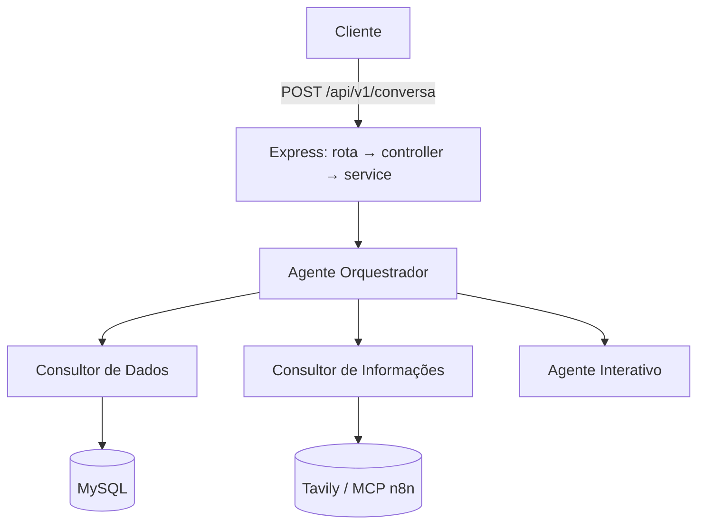

# 🛒 Agente completo de supermercado

> Base de uma API com **múltiplos agentes de IA** para um supermercado: consulta de dados no MySQL, informações externas e conversa interativa. **Em construção.**


## Estado atual (transparência)

| Parte | Situação |
|---|---|
| Servidor Express, rotas, controller, service, tratamento de erros 404/500 | ✅ pronto |
| Conexão com MySQL (pool) e verificação na inicialização | ✅ pronto |
| Modelagem do banco (`schema.sql`) | ✅ pronta |
| Agentes (orquestrador, consultor de dados, consultor de informações, interativo) e modelos | 🚧 arquivos criados, **ainda vazios** |
| `POST /api/v1/conversa` | 🚧 valida a pergunta e responde `OK`; ainda não chama os agentes |

## Arquitetura planejada



O desenho segue o padrão que já uso em outros projetos: orquestrador que delega a agentes especialistas (veja [multi_agents_financeiro](https://github.com/joseaugustodearaujoaraujo1-lgtm/multi_agents_financeiro)).

## Como rodar o que já existe

```bash
git clone https://github.com/joseaugustodearaujoaraujo1-lgtm/agent_completo_supermercado.git
cd agent_completo_supermercado
npm install
```

1. Execute `schema.sql` no MySQL (cria o banco `multi_agents_mercado`).
2. `cp .env.example .env` e preencha o banco e as chaves.
3. `npm run dev` (porta `3001`).

```bash
curl -X POST http://localhost:3001/api/v1/conversa \
  -H "Content-Type: application/json" -d '{"pergunta":"oi"}'
# {"Resposta":"OK"}
```

## Estrutura

```text
├── main.js · routes/ · controllers/ · service/   # camadas da API
├── connect/database.js · schema.sql              # MySQL
└── IA/ agentes/ · modelos/ · prompts/            # agentes (em construção)
```

## Próximos passos

- [ ] Implementar os modelos (OpenRouter, Groq, embeddings).
- [ ] Implementar o consultor de dados com consultas SQL parametrizadas.
- [ ] Implementar o orquestrador e ligar ao `service`.
- [ ] Histórico por usuário e autenticação.
